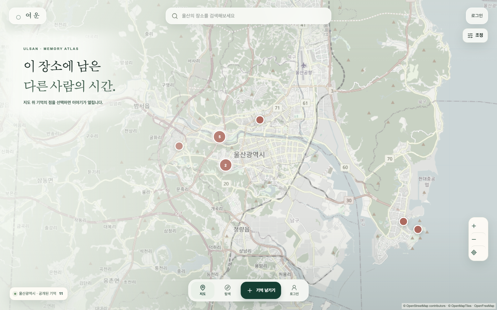
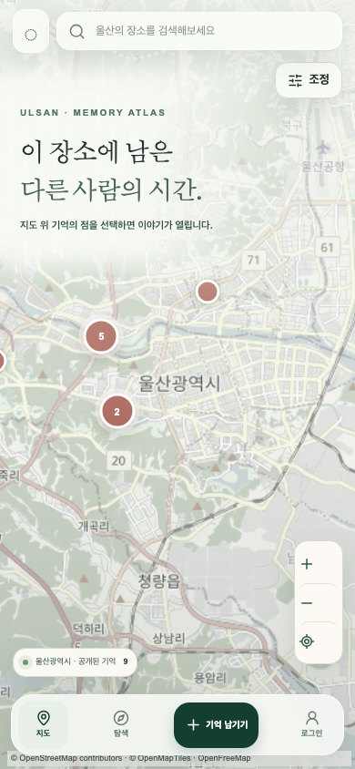
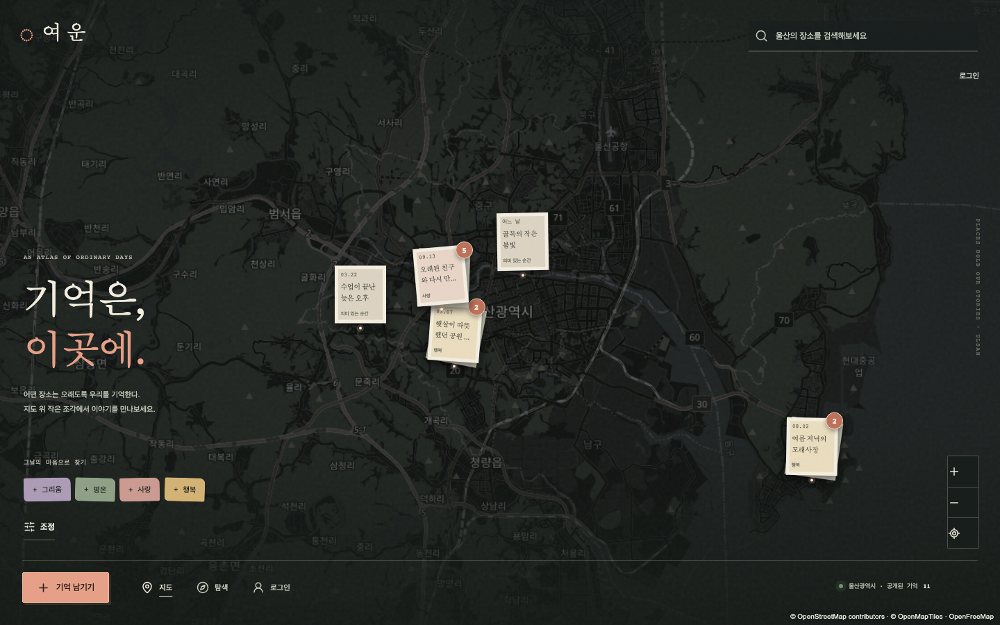
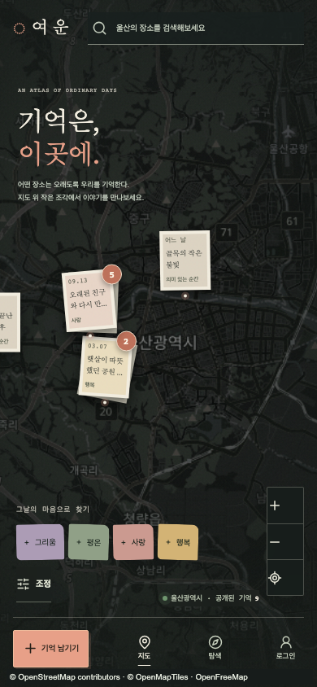
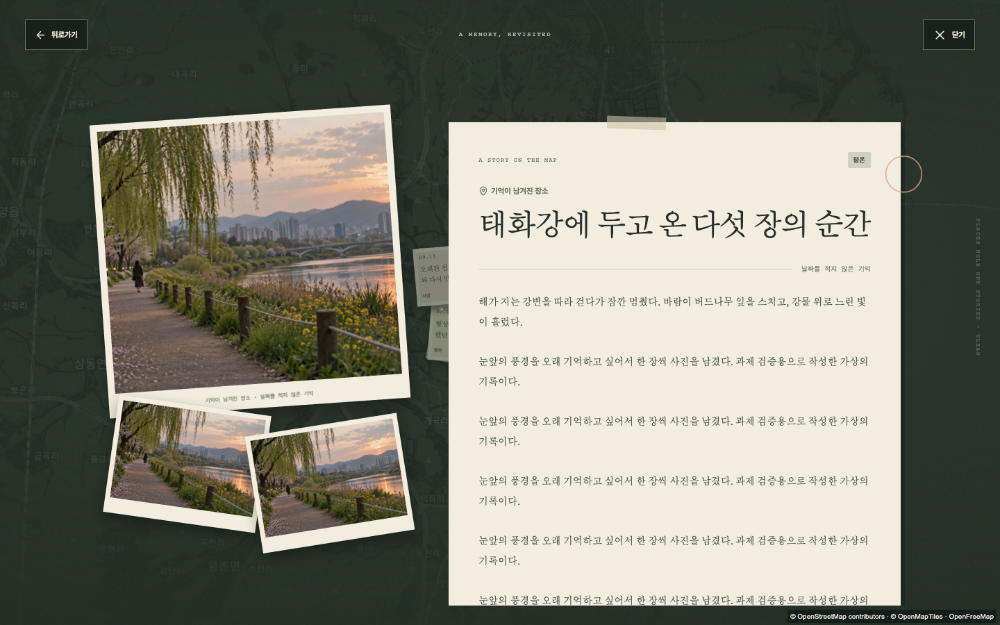
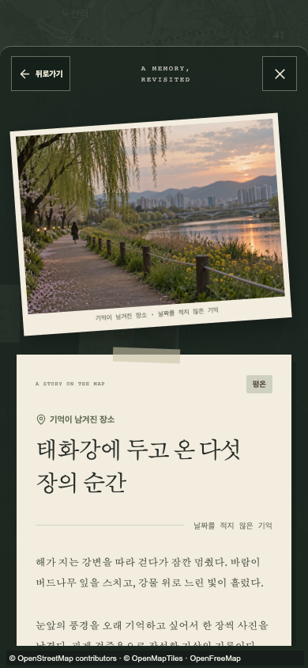

# yeoun_2 — Memory Atlas 구현 결과

2026-10-18 · `redesign/yeoun-2`

## 완료한 범위

La Gata Perduda 지도 레퍼런스 분석을 바탕으로 실제 앱 UI를 리디자인했습니다. 어두운 전체 지도, 지리적으로 연결된 사진/글 스탬프, 감정 칩, 하단 왼쪽 CTA, 맥락 종이 미리보기, 감정 색조와 비대칭 읽기 장면을 구현했습니다. 모바일도 같은 기능을 터치·하단 시트로 제공합니다.

원본 `yeoun-memory-atlas` 저장소와 사이트는 수정하지 않았습니다. yeoun_2의 `main`과 `baseline-2026-10-18` 태그도 기준 상태로 보존합니다.

## 재사용한 기능과 변경 경계

서버·API·DB schema·기억 DTO·저장소·인증 모듈은 변경하지 않았습니다. 복사본에 남아 있던 `.openai/hosting.json`의 원본 `project_id`는 제거해 원본 Site로 잘못 배포되지 않게 했습니다. 로컬 D1/R2 binding은 유지합니다. 장소 검색, 지도 조정, 현재 위치, 위치 선택 작성, 사진 업로드, 공개/비공개 저장, 내 기억 수정·삭제, 삭제 확인, 튜토리얼과 개발 보조 진입점을 유지합니다.

`map.tsx`는 lifecycle·raster layer·좌표 변환을 유지하며 stamp 표현 옵션만 추가했습니다. 종이 마커 충돌 반경 72px는 화면 표현용이며 기존 서버 반경 100m와 구분됩니다. 지리적으로 떨어진 화면 묶음은 클릭 시 확대해 개별 지점으로 드러납니다. 출처 표기는 분위기 효과로 어두워지지 않도록 독립 계층으로 옮겼습니다.

상세는 `spatial-panels.tsx`에서 실제 DTO를 계속 사용합니다. 같은 장소 이전/다음은 기존 그룹 결과를 재사용하며 새로운 추천 기능은 추가하지 않았습니다.

## 주요 파일

- `app/memory-atlas.css`: 새 디자인 토큰·반응형·모션·공통 표면
- `components/memories/memory-stamp.tsx`: 사진/텍스트/묶음 마커
- `components/memories/atlas-atmosphere.tsx`: 질감·감정 색조·선택적 커서 링
- `components/memories/map.tsx`: 기존 단일 overlay에 stamp 표현 연결
- `components/memories/spatial-panels.tsx`: 맥락 미리보기·읽기 장면
- `components/memory-app.tsx`: 실제 검색/필터/장소/상세/작성 여정 연결
- `components/my-memory-map.tsx`: owner 지도 표현 연결
- `app/layout.tsx`, `github-pages/main.tsx`: 두 런타임의 동일 CSS 연결
- `tests/e2e/atlas.spec.ts`: 기능 및 장문·사진·접근성 회귀 검사
- `docs/design/DESIGN-DNA.md`: 새 디자인 체계

## 실제 검증 결과

- `pnpm check`: lint, typecheck, 단위 테스트 10개, Worker build, Pages build 통과
- `pnpm test:ui`: 데스크톱·모바일 총 18개 통과
- 초기 새 검증의 현재 위치 테스트는 도시 중심으로 확대 후 화면 밖의 국가정원 마커를 찾으면서 실패했습니다. 위치 mock을 검증 장소 근처로 조정하고 동일 시나리오를 다시 실행해 통과했습니다. 제품 assertion은 삭제하지 않았습니다.
- 사진 5장과 장문 상세: 모든 사진·내용의 내부 스크롤, 닫기 도구의 화면 내 유지, Tab/ Escape 복귀 확인
- 비공개 기억: 공개 스탬프와 탐색에 미노출, owner 목록에는 노출 확인
- 장소 검색·지도 확대/드래그·장소별 여러 기억·공개 작성·사진·수정·삭제 흐름 확인
- 페이지 오류를 수집하는 공개 탐색 및 사진/장문 시나리오에서 오류 0건
- 새 복사본의 로컬 D1에 기존 migration/가상 seed 적용, Worker 실제 페이지 200 응답 및 공개 API 11건 확인. user ID·이메일·원좌표 필드 미노출. 실제 브라우저에서 서버 기억 미리보기/상세 조회와 console error 0건 확인. Worker 전체 CRUD는 별도 재검증하지 않았고 CRUD 브라우저 자동 검사는 Pages 모드에서 수행함
- 가로 document overflow 없음
- 새 디자인에 맞춘 첫 사용자 안내 10단계와 화면 내 배치 확인
- 공개/내 기억 skip link가 Pages hash route로 잘못 이동하지 않고 실제 목록을 펼치고 초점을 옮기도록 수정. 공개 목록의 키보드 건너뛰기 자동 검사 통과
- 기존 비차단 bundle 크기 경고와 Vinext route 정적 분류 안내는 남아 있음

테스트의 작성·수정·삭제는 Playwright 격리 브라우저의 IndexedDB에만 수행했습니다. 원본 DB나 기존 사용자 데이터를 초기화하지 않았습니다. 사진은 저장소에 이미 있던 가상의 시안 자산을 QA fixture로 사용했으며 공개 seed의 실제 사진인 것처럼 추가하지 않았습니다.

## Lovable 사용 및 제한

사용자가 선택한 Lovable에서 별도 디자인 워크벤치를 만들었습니다.

- Editor: https://lovable.dev/projects/10adbee3-41ec-4f95-965f-c003c301a75b
- 생성된 디자인 commit: `241be74124800f8dcc936b4642a0560e4e22d31f`
- 디자인 CSS와 MemoryScene을 읽고 색상 역할, 겹친 종이·사진, 모바일 분리 원리를 검토해 기존 앱에 맞게 구현했습니다.
- 생성된 워크벤치에는 TypeScript 오류 4개가 있었고, 수정 요청은 무료 크레딧 소진으로 거절됐습니다. 추가 결제·업그레이드를 진행하지 않았습니다.
- 워크벤치의 별도 타입·가상 액션·Kakao 연결·Seoul로 보이는 생성 사진·새 프레임워크는 실제 앱에 가져오지 않았습니다. 실제 기능은 기존 저장소에 통합하고 검증했습니다.
- Lovable에 새 DB·인증·storage를 생성하지 않았고 해당 워크벤치를 공개 배포하지 않았습니다. 이 워크벤치를 완성 서비스 URL로 안내하지 않습니다.

## 화면 증거

### 변경 전

### 변경 후

### 가상 테스트 기록의 사진·장문 상세

## 알려진 실행 경계

Pages는 기존처럼 브라우저 로컬 저장과 로컬 시연 세션을 사용합니다. 사용자 간 기록 공유나 운영 계정 인증으로 해석하면 안 됩니다. Worker 서버 모드는 기존 D1/R2·인증 계약을 유지합니다.

NAVER 거리뷰는 기존 Client ID/서비스 URL 설정이 있어야 실제 조회를 할 수 있습니다. 새 저장소에서 원본 GitHub 변수로 가져올 수 있는 Client ID를 찾지 못했으므로 임의의 키를 추가하지 않았습니다. 기존 SDK 지연 로딩과 설정 안내·오류 처리 UI는 유지됩니다.

실기기 iOS/Android, 전체 WCAG 평가, 저사양 GPU FPS, 실제 NAVER panorama 응답은 이번 브라우저 테스트로 검증했다고 주장하지 않습니다.

## 배포 경로

공개 UI 주소: https://adammyun.github.io/yeoun_2/

GitHub Pages workflow는 `redesign/yeoun-2`에서 수동 실행합니다. `main` 기준 상태와 원본 사이트를 덮어쓰지 않습니다. 정적 Pages의 저장·인증 제한은 위와 같습니다.
