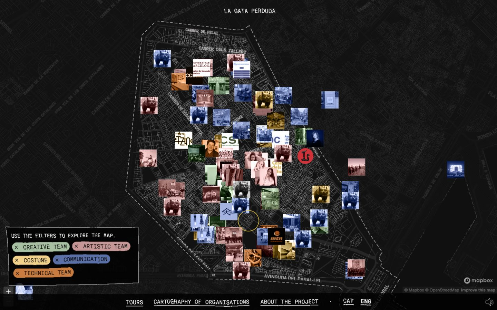
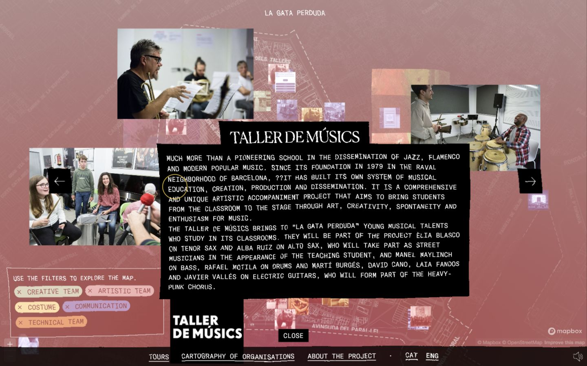
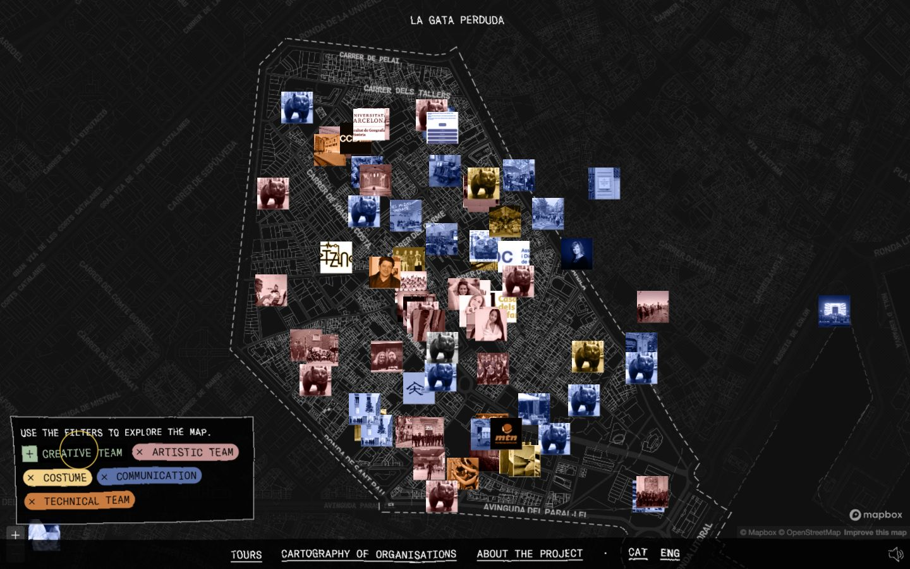
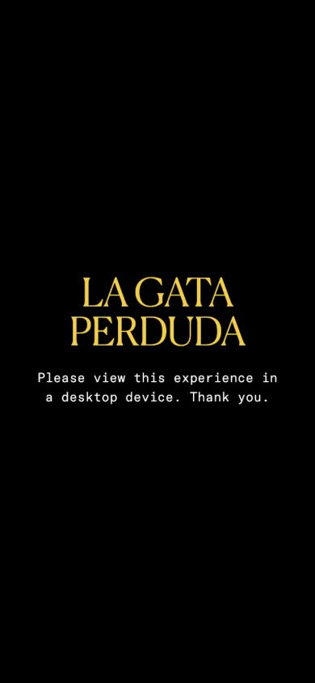

# La Gata Perduda — yeoun_2 리디자인 레퍼런스 검증

확인일: 2026-10-18 (Asia/Seoul)
대상: <https://lagataperduda.com/en/mapa/>
작업 브랜치: `redesign/yeoun-2`

## 판단

**여운의 데스크톱 탐색 경험을 새롭게 설계하는 모델로 적합하다.** 지도 위 사진으로 이야기에 진입하고 선택한 이야기의 분위기가 화면 전체로 확장되는 방식이, 한 장소에 여러 사람의 기억이 쌓인다는 제품 개념과 잘 맞는다.

단, 이 사이트는 실제 확인한 모바일 폭에서 탐색을 제공하지 않는다. 여운의 모바일 UX, 작성·수정 기능, 늘어나는 사용자 콘텐츠, 긴 본문을 위한 규칙은 별도로 설계해야 한다. 따라서 시각적 구성과 전환 원리를 채택하고 여운의 기존 기능 기준선을 결합하는 접근을 권한다.

이번 작업에서는 레퍼런스를 직접 조작하고 현재 여운 소스와 비교했다. 서비스 소스, API, DB, 기존 디자인 DNA 및 Skill은 변경하지 않았다. 이 문서와 검증 스크린샷만 추가했다.

## 검증 방법과 범위

- 실제 인앱 브라우저에서 페이지 접속, 언어 선택, 설명 닫기, 사진 마커 선택, 다음 장소 이동, 상세 닫기, 필터, 확대 및 드래그를 수행했다.
- 데스크톱 `1440×900`, 모바일 `390×844`를 확인하고 임시 viewport 설정을 원래대로 복원했다.
- 화면 캡처, 접근성 트리, DOM에 노출된 마커 및 글꼴 속성, 수집된 콘솔 로그를 확인했다.
- 수치 기반 FPS, 저사양 실기기 성능, 전체 접근성 준수, 모든 브라우저, 모든 hover 효과와 오디오 품질은 검증하지 않았다. 부드러움에 관한 평가는 조작 중의 시각적 관찰이며 성능 보증이 아니다.
- 홈페이지·Tours 등 다른 경로 전체를 검증한 보고서가 아니다. 지정된 지도 경로가 대상이다.

## 실제로 확인한 화면 구조

이 지도는 오페라 공동 제작에 참여한 단체와 사람들을 소개한다. 사용자마다 자유롭게 기록을 생성하는 여운과는 콘텐츠의 규모와 작성 방식이 다르다.

| 요소 | 관찰한 구성 | 여운에서 가져올 원리 |
| --- | --- | --- |
| 바탕 | 화면 전체의 어두운 지도, 가는 도로·구역 선, 약한 텍스처 | 주변 정보는 낮은 위계로 두고 사람의 기록을 전경으로 배치 |
| 사진 마커 | 일반 POI 핀 대신 사진·로고 조각. 확인한 마커는 50×50 CSS px | 사진이 곧 기억의 진입점이 되도록 구성 |
| 카테고리 | 좌하단의 색상별 칩, 불규칙한 선으로 둘러싼 작은 필터 영역 | 탐색 기준을 지도와 가까운 위치에서 조작 |
| 내비게이션 | 상단 작은 브랜드, 하단 가장자리의 텍스트 링크 | 중앙 탐색 공간을 확보하는 가장자리 UI |
| 상세 | 사진 여러 장, 큰 제목, 검은 본문 면이 비대칭으로 배치됨 | 고정된 우측 카드보다 기록 하나를 하나의 장면으로 표현 |
| 시각 언어 | 인쇄물 같은 거친 가장자리, 사진의 색조, 모노스페이스 본문과 serif 제목 | 여운 고유의 한국어 타이포그래피와 기록의 물성으로 재해석 |

지도에서 사진들이 자유로워 보이지만, 이동·확대에 맞춰 지점을 따라간다. 상세 장면의 비대칭 배치와 지도 마커의 지리적 위치는 구분해야 한다. 여운에서도 실제 위치를 임의의 화면 좌표로 흩트리는 방식은 적합하지 않다.

현재 여운은 전체 지도 + Floating Search/Navigation + 장소 미리보기 + 한쪽 상세 패널을 사용한다. 레퍼런스를 적용한다면 변화의 핵심은 단순히 표면색이나 모서리가 아니라 **지도 위의 주인공을 점에서 사진·기록 조각으로 바꾸고, 상세를 하나의 공간 장면으로 만드는 것**이다.

## 실제 인터랙션 검증

| 항목 | 결과 및 근거 | 해석 |
| --- | --- | --- |
| 첫 진입 | 언어 선택 후 지도 설명이 나타나고 닫으면 지도가 드러남 | 장면을 순서대로 소개하는 구조. 여운에서는 기존 튜토리얼과 중복되지 않게 축약 필요 |
| 사진 선택 | 사진·제목·본문이 들어오면서 지도 위 전경이 재구성됨 | 사진 카드 하나의 확대보다 넓은 장면 전환 |
| 배경 반응 | 상세 대상에 따라 배경이 분홍 또는 녹색 계열로 변화함 | 선택의 분위기를 주변 공간까지 확장. 본문 대비는 별도 표면으로 확보 |
| 다음 장소 | 상세 상태에서 다음 버튼으로 제목·본문·사진이 바뀜 | 지도로 돌아오지 않고 여러 이야기를 읽을 수 있음 |
| 닫기 | 상세 전경이 사라지고 기존 지도 탐색으로 복귀함 | 배경 지도 상태를 유지하는 연속성 |
| 필터 | Creative Team을 끄면 확인한 DOM 마커 버튼 수가 116 → 97로 감소함 | 실제 항목이 지도에서 제외됨. 이 숫자는 고유 단체 수나 성능 상한을 뜻하지 않음 |
| 지도 이동 | 확대 버튼과 드래그로 지도·사진 위치가 함께 바뀜 | 지리적 앵커와 화면 조작이 연결됨 |
| 커서 | 포인터 위치 주변의 노란 원형 커서가 화면과 선택 대상 위에 표시됨 | 선택적 데스크톱 보조 표현으로 참고 가능. 추종 알고리즘이나 관성 값은 미확인 |
| 모바일 | 390px 폭에서는 데스크톱 이용 안내만 표시되고 지도·필터·상세 탐색이 제공되지 않음 | 모바일 레이아웃의 참고 모델로는 부족함 |
| Escape | 확인한 상세 화면에서는 Escape 후에도 상세가 열려 있었음 | 여운의 기존 Escape 닫기를 유지해야 함 |

클릭 직후와 전환 완료 후의 화면에서 사진·텍스트·색조가 단계적으로 달라지는 것을 확인했다. 정확한 easing, 전체 전환 시간과 shared-element 전환 구현 여부는 확정하지 않았다. 모든 hover·parallax 효과를 검증했다고 주장하지 않는다.

## 기술적으로 확인한 사실과 불확실성

- 레퍼런스에 Mapbox 표기와 `mapboxgl-marker` 클래스가 있다. 여운의 MapLibre를 교체해야 한다는 근거는 아니다.
- 확인한 사진 마커의 computed transition에는 `opacity 0.2s`가 있었다. 전체 상세 전환이 이 속성만으로 구현됐다는 의미는 아니다.
- DOM에서 본문 글꼴은 `GT America Mono`, 상세 제목은 `Canela` 계열로 확인됐다. 이 글꼴의 재사용 권한이나 소스 라이선스는 확인하지 않았다. 여운에는 허용된 별도 한국어 글꼴 체계가 필요하다.
- 콘솔에서 GSAP의 언어 선택 대상 관련 경고 1건을 확인했다. GSAP이 관여한다는 단서는 있지만 전체 모션 구조와 버전은 확인하지 않았다. 이 경고를 지연의 원인으로 판단할 근거도 없다.
- 사진 마커의 접근 가능한 이름은 확인한 항목 모두 일반적인 Map marker였다. 상세를 연 뒤 초점이 기존 필터 입력에 남아 있는 사례도 관찰했다. 이는 제한된 관찰이며 전체 사이트에 대한 접근성 판정은 아니다.
- 클러스터링, viewport 단위 서버 조회, 원본 사진 최적화, 데이터베이스 및 인증 구조는 이번 검증에서 확인하지 않았다. 마커 116개가 보인다는 사실로 확장성을 추정하지 않는다.

## 여운에 권하는 적용 범위

### 채택할 요소

1. **사진과 글 조각이 놓인 기억 지도.** 사진이 있는 기억은 허용된 첫 사진을 진입점으로, 사진이 없는 기억은 날짜·짧은 제목·감정이 있는 작은 종이 조각으로 표현한다. 가짜 사진을 채우지 않는다.
2. **공간의 연속성을 지키는 전환.** 선택 → 장소의 여러 기억 → 개별 기억 → 복귀에서 지도 중심과 확대 상태를 유지한다. 새 지도를 다시 만들지 않는다.
3. **기록에 따라 달라지는 배경 분위기.** 감정의 색을 약하게 주변에 반영하고 읽는 본문은 충분히 대비되는 표면 위에 둔다. 감정 정보는 글자로도 제공한다.
4. **비대칭 Editorial 상세.** 데스크톱에서 사진·제목·본문을 자유롭게 구성하되 읽기 순서와 닫기·뒤로가기는 일정하게 둔다.
5. **가장자리 내비게이션과 가벼운 조작 피드백.** 지도 중앙을 탐색에 내주고 검색·조정·기억 남기기·내 기억의 접근성은 유지한다.

### 여운에 맞게 바꿔야 할 요소

| 레퍼런스의 방식 | 여운의 요구에 맞는 조정 |
| --- | --- |
| 많은 개별 사진의 중첩 | 기존 클러스터를 유지하고 낮은 zoom에서는 사진 묶음과 개수, 가까워지면 개별 기록을 표시. 겹침 때문에 클릭 대상을 잃지 않도록 검증 |
| 제한된 분량의 편집된 콘텐츠 | 제목 100자·본문 10,000자·사진 0/1/5장 상태를 처리하는 상세 템플릿. 고정 top/left로 모든 콘텐츠를 배치하지 않음 |
| 데스크톱 전용 경험 | 모바일에서는 tap → 하단 미리보기 → 내부 스크롤 상세. hover나 커서 없이 동일 기능 제공 |
| 범주별 필터 | 기존 연도·감정·공개 범위 및 간결/상세 지도 기능을 재배치하되 의미와 URL 동기화 유지 |
| 장소 간 이전/다음 | 우선 기존 같은 장소의 기억 목록을 활용. 새로운 추천·랭킹 기능으로 확대하지 않음 |
| 독특한 커서 | fine pointer에서만 선택적으로 적용. 기본 커서를 유지하거나 이해 가능한 보조 링으로 제한 |
| 음악과 표현 효과 | 오디오는 리디자인 필수 요소로 삼지 않음. 모션은 사용자가 줄일 수 있게 설계 |

모바일에는 지도와 터치 목표를 먼저 배치한다. 사진 마커는 최소 조작 면적을 확보하고 작은 화면에서는 기존 장소 그룹을 적극 사용한다. 상세 시트의 본문 스크롤이 지도 확대·이동 제스처로 해석되지 않게 경계를 유지한다. 검색·조정·작성 버튼을 동시에 여러 곳에 복제하지 않는다.

## 기존 코드와의 연결 가능성

현재 코드에서 아래 연결 지점을 직접 확인했다.

| 현재 파일 | 재사용할 기능 | 향후 표현 작업 |
| --- | --- | --- |
| `components/memories/map.tsx` | MapLibre lifecycle, requestAnimationFrame 기반 화면 동기화, 단일 HTML marker overlay, grouping, size 보정, raster 호환 계층 | 동일 overlay에서 사진/텍스트 마커의 내부 표현을 교체 |
| `components/memory-app.tsx` | viewport 조회, 검색, 필터, 위치 선택, 장소·상세 상태 연결 | 화면 장면과 조작 배치 변경 |
| `components/memories/spatial-panels.tsx` | 실제 기억·장소 그룹 데이터, 상세 내용, 복귀·닫기 | 독립된 장면 구성과 모바일 시트 표현 |
| `src/features/memories/api.ts` 및 서버 모듈 | Worker/Pages 데이터 경계와 권한 처리 | 기존 계약을 사용하며 표현 때문에 원좌표·작성자 정보를 추가 요청하지 않음 |
| `app/spatial-live.css` | 현재 시각 표현의 경계 | 새 범위의 시각 토큰·표현을 설계할 때 기준선으로 보존 |

MapLibre의 위치 계산과 사진의 hover/선택 모션을 같은 요소의 transform으로 충돌시키지 않는다. 마커 위치는 기존 overlay가 담당하고 사진의 확대·기울임은 내부 요소에 적용하는 방식이 적합하다. 지도 이동마다 무작위 위치나 기울기를 다시 뽑지 않는다.

기존 raster 호환 계층·container size 보정·attribution·울산 fallback을 유지한 상태에서 적용할 수 있다. 두 지도 모드의 사진 마커를 각각 만들지 않는다. React/CSS 또는 Web Animations API로 작은 전환부터 검증할 수 있으므로, 레퍼런스에 GSAP이 보인다는 이유만으로 새 모션 라이브러리를 먼저 설치할 필요는 없다.

공개 마커의 사진도 기존 공개 DTO·media 권한을 통해서만 얻는다. 익명 작성자 정보와 approximate 원좌표를 애니메이션 metadata, 이미지 속성, 툴팁에 추가하지 않는다. private/unlisted의 사진·개수도 공개 장면에 나타나면 안 된다.

## 구현 전 지켜야 할 모션·성능 기준

아래는 레퍼런스의 실측값이 아니라 여운에 제안하는 검증 기준이다.

- hover·버튼 피드백은 약 160–220ms, 선택·상세의 주요 전환은 약 280–450ms부터 검토한다. 버튼 사용을 애니메이션 완료까지 잠그지 않는다.
- 한 번의 선택에서 사진, 본문, 배경이 서로 다른 강도로 무한 반복하지 않게 한다. 모션은 위치와 단계 관계를 설명해야 한다.
- 지도 팬·줌 자체에 별도 smooth-scroll이나 휠 가속기를 덧씌우지 않는다. 콘텐츠 스크롤과 지도의 제스처를 구분한다.
- viewport 조회·기존 grouping을 유지한다. 모든 기억과 모든 고해상도 사진을 처음부터 받지 않는다. 대표 썸네일과 전체 사진의 로딩 시점을 나눠 검증한다.
- `prefers-reduced-motion`에서는 큰 이동·기울임·포인터 추종을 줄이고 같은 정보와 행동을 제공한다.
- 지도 이동 중 단순 transform/opacity 중심으로 검증하며, 전체 지도에 무거운 blur·필터를 매 프레임 적용하지 않는다.
- 실제 기기에서 지도 이동·사진 로드·상세 전환이 동시에 일어나는 경우를 측정한 뒤 효과의 양을 결정한다. 이번 조사로 저사양 성능이 보장된 것은 아니다.

## 가장 작은 다음 단계

기존 서비스는 유지하고 `yeoun_2`의 별도 미리보기 경로에 **하나의 기억 지도 시안**을 만든다. 여러 전면 시안을 다시 나열하기보다 이 레퍼런스의 장면 구성을 먼저 검증하는 것이 적합하다.

검증할 장면은 기본 지도, 밀집 장소의 사진/글 조각 선택, 같은 장소 여러 기억, 사진과 장문 상세, 모바일 하단 시트다. 울산의 기존 가상 seed·허용된 실제 DTO를 사용하고 샘플 또는 미연결 기능은 표시한다. 선택이 확정된 뒤 기존 사용자 동선을 연결한다.

합격 기준:

- 현재와 구조적으로 다른 사진·기록 중심의 장면이 보일 것
- 검색, 필터, 장소 선택 작성, 내 기억, 닫기·뒤로가기를 유지할 것
- 사진 없음/여러 사진/긴 제목/긴 본문에서 읽기와 조작이 막히지 않을 것
- 모바일, 키보드, reduced-motion, raster fallback에서도 동작할 것
- 간결/상세 전환 뒤 위치·선택·마커가 일치할 것
- 공개/비공개·익명·대략적 위치의 데이터 경계를 유지할 것
- 데스크톱·모바일 Playwright 캡처와 기존 기능 테스트로 확인할 것

## 검증 화면

아래 이미지는 분석을 위해 직접 캡처한 타사 사이트의 화면이다. 여운의 제품 이미지나 재사용할 서비스 자산이 아니다.

### 데스크톱 기본 지도

### 데스크톱 상세 장면

### 필터 적용

### 모바일 제한

## 요약

채택할 핵심은 **사진과 기록이 놓인 공간, 콘텐츠에 반응하는 장면, 탐색의 연속성**이다. 모바일·UGC·장문·작성·접근성은 여운의 제품 기준을 적용한다. MapLibre와 기존 기능을 보존하며 구현할 수 있으므로, 조건부로 적합한 리디자인 모델로 판단한다.
