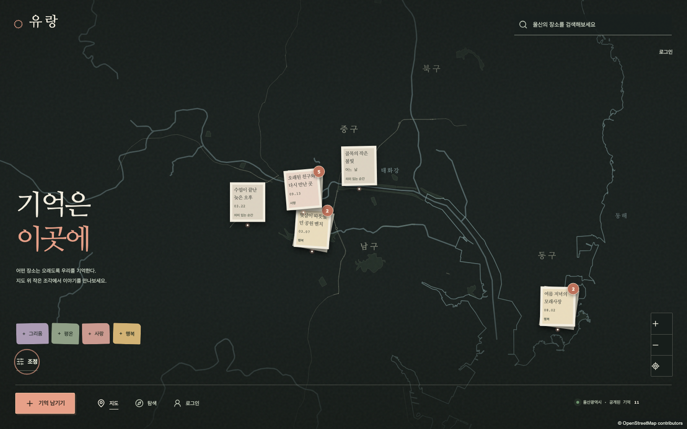
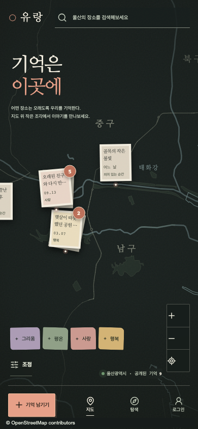
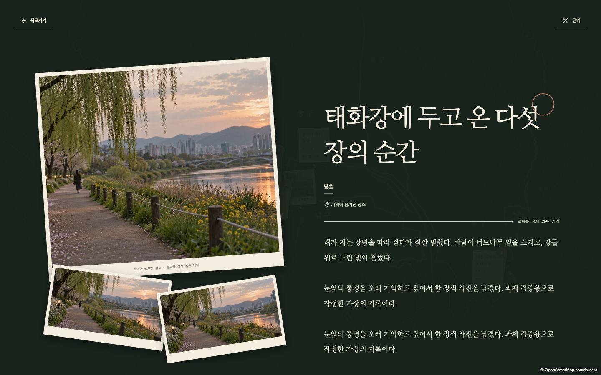
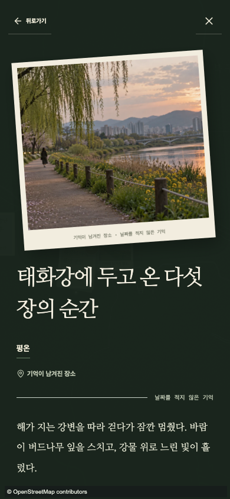
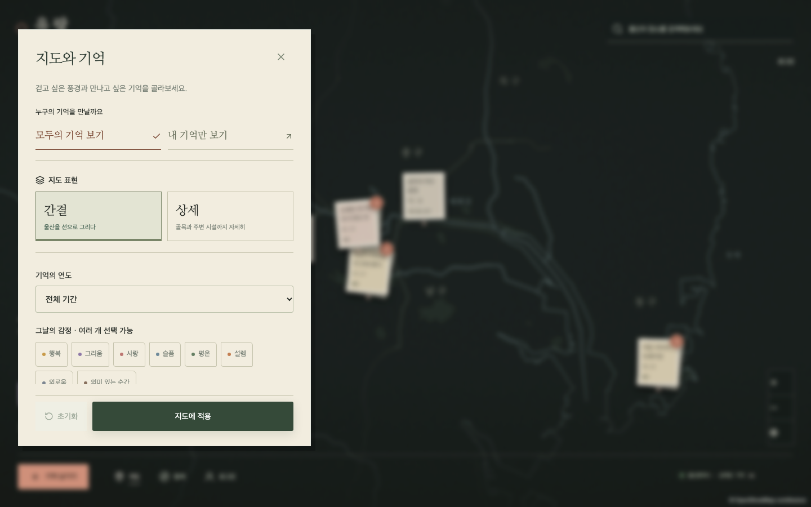
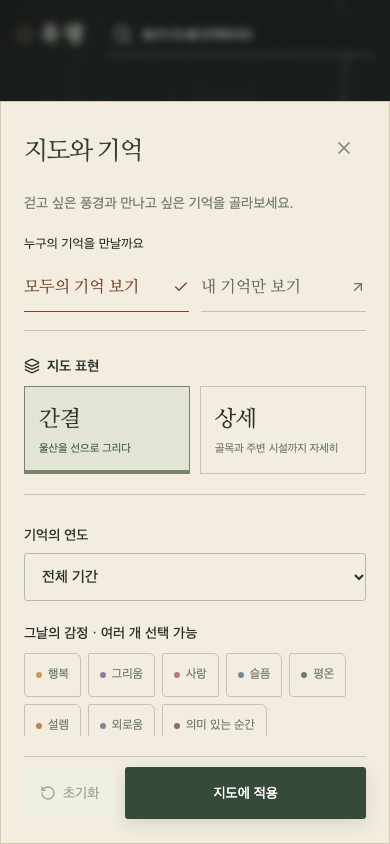

# 유랑 UI 보완 결과

2026-10-19 · `redesign/yeoun-2` · 공개 경로 https://adammyun.github.io/yeoun_2/

## 요청 반영

- 브랜드를 여운에서 **유랑**으로 변경했습니다. 저장소 이름·브라우저 저장 key·기존 사용자 데이터는 보존합니다.
- 메인 제목은 구두점 없는 **기억은 / 이곳에**입니다. 로컬 나눔명조 WOFF2를 포함해 제목이 기기의 고딕 폴백에 의존하지 않게 했습니다. OFL 고지를 `public/fonts/`에 보존합니다.
- 메인·미리보기·상세·장소 목록·작성·로그인·개발 보조·튜토리얼의 제목 위 장식 문구를 제거했습니다. 날짜와 감정 등 실제 정보는 제목 아래에 둡니다. 사용자가 작성한 제목과 본문을 임의로 변경하지 않습니다.
- 간결 지도는 울산의 주요 도로·하천·해안선·큰 공원만 그리는 자체 SVG 라인 스타일입니다. OSM 데이터 336개 지형을 단순화했으며 실제 지리 좌표를 사용합니다. 출처·원본 기준 시각·범위·ODbL은 [지도 설명](../../public/maps/README.md)에 명시합니다.
- 상세 지도와 간결 지도는 동일한 MapLibre 카메라·Web Mercator 투영·마커 overlay를 사용합니다. MapLibre·container size fix·ResizeObserver·raster compatibility를 제거하지 않았습니다.
- 라인 데이터 범위 밖이거나 해당 파일을 읽지 못하면 기존 OSM standard raster로 표시합니다. 울산 fallback과 현재 위치 권한 정책은 유지합니다. 앱에서 Overpass 호출이나 오프라인 타일 다운로드를 하지 않습니다.
- 기억 상세의 사각 종이 본문 틀을 걷어내고 큰 세리프 제목·비대칭 사진 묶음·열린 본문으로 바꿨습니다. 사진이 없으면 가짜 사진 대신 감정의 선 모티프를 표시합니다. 모바일은 독립적인 내부 스크롤을 유지합니다.
- 내 기억 상세도 공통 `SpatialMemoryDetail`을 사용합니다. 기존 수정·삭제 확인·공개 범위·owner 권한을 유지합니다.
- 장소의 다른 기억 진입은 밑줄과 화살표로 표현하고 조정은 종이 테마로 재구성했습니다. 조정의 **모두의 기억 보기 / 내 기억만 보기**는 기존 `/`와 `/my-map`으로 이동하며 연도·감정 필터를 전달합니다. 비로그인은 기존 로그인 화면을 거칩니다. 공개 query에 비공개 데이터를 합치지 않습니다.

## 수정 위치

| 영역 | 주요 파일 |
| --- | --- |
| 테마·글꼴·반응형 | `app/memory-atlas.css`, `public/fonts/` |
| 지도 | `components/memories/map.tsx`, `ulsan-line-map.tsx`, `public/maps/` |
| 미리보기·상세 | `components/memories/spatial-panels.tsx`, `memory-stamp.tsx` |
| 조정·기억 범위 | `components/memories/memory-filter-sheet.tsx`, `memory-scope-switch.tsx` |
| 실제 화면 연결 | `components/memory-app.tsx`, `components/my-memory-map.tsx` |
| 브랜드·장식 문구 | App Router/Pages entry, 로그인, 튜토리얼, 작성·장소·거리뷰·개발 보조 화면 |
| 회귀 확인 | `tests/e2e/atlas.spec.ts`, `tests/e2e/home.spec.ts` |

API·인증·저장소·DB schema 및 `src/`의 비즈니스 로직은 변경하지 않았습니다. 원본 저장소·사이트와 `yeoun_2/main`을 보존합니다.

## 실제 검증

- `pnpm check` 통과: lint·typecheck·단위 테스트 10개·Worker build·Pages build.
- 최종 `pnpm test:ui` 데스크톱 1440×900 / 모바일 390×844 및 낮은 화면 1280×720 / 390×667 **26개 통과**.
- 실제 공개 화면의 낮은 데스크톱 창에서 조정의 sticky footer가 필터 내용을 가리는 문제를 발견해 수정했습니다. 제목·닫기와 적용 버튼을 고정하고 필터 내용만 독립 스크롤합니다. 마지막 감정 버튼과 적용 버튼이 겹치지 않는지 두 낮은 viewport에서 검사하고 캡처했습니다.
- Vite 개발 환경의 `/public/fonts` 경로 경고를 제거하고 `/fonts` public asset 경로를 사용합니다. Pages build가 `/yeoun_2/fonts`로 변환하는 것과 실제 글꼴 로딩을 재검증했습니다.
- 신규 검사: 두 지도 모드에서 같은 마커 위치 오차 1px 미만, 로컬 세리프 로딩, 장식 overline 미노출, 조정의 마지막 감정 선택·초기화, 기억 범위 전환과 로그인 경계·필터 전달, 라인 파일 실패와 울산 밖 현재 위치의 raster fallback.
- 기존 사진 5장·장문 스크롤·공개/비공개 분리·검색·확대/드래그·장소별 기억·작성·사진·수정·삭제·현재 위치·reduced motion·키보드·튜토리얼 10단계 검사 유지.
- 첫 신규 모바일 검사에서 데스크톱 전용 heading을 찾는 테스트가 실패했습니다. 모바일의 실제 owner route·목록·선택된 scope를 검사하도록 수정했습니다. 사진·개인정보·CRUD assertion은 유지했습니다.
- Worker 로컬 HTTP 페이지 200과 라인 GeoJSON 336개 응답을 확인했습니다. Worker 전체 CRUD 브라우저 검증은 별도로 수행하지 않았습니다. CRUD 자동 검사는 격리된 Pages IndexedDB에서 수행했습니다.
- 개발용 Pages HMR 중 기존 entry의 중복 createRoot 경고를 관찰했습니다. 배포용 Pages build를 대상으로 실행한 최종 E2E는 통과했습니다. 개발 서버 설정은 변경하지 않았습니다.
- 기존 bundle 크기 경고·Vinext route 정적 분류 안내는 남아 있습니다. 실기기 iOS/Android·실제 NAVER panorama·저사양 GPU FPS는 미검증입니다.

## 화면

[이전 화면](memory-atlas/after-desktop.png)

사진 상세는 기존 가상 이미지로 만든 격리된 QA 기록입니다. 실제 공개 seed에 임의의 사진을 추가하지 않았습니다.

Pages는 기존처럼 브라우저 로컬 시연 저장·인증을 사용합니다. 운영용 사용자 간 공유 백엔드로 변경한 작업은 아닙니다.
